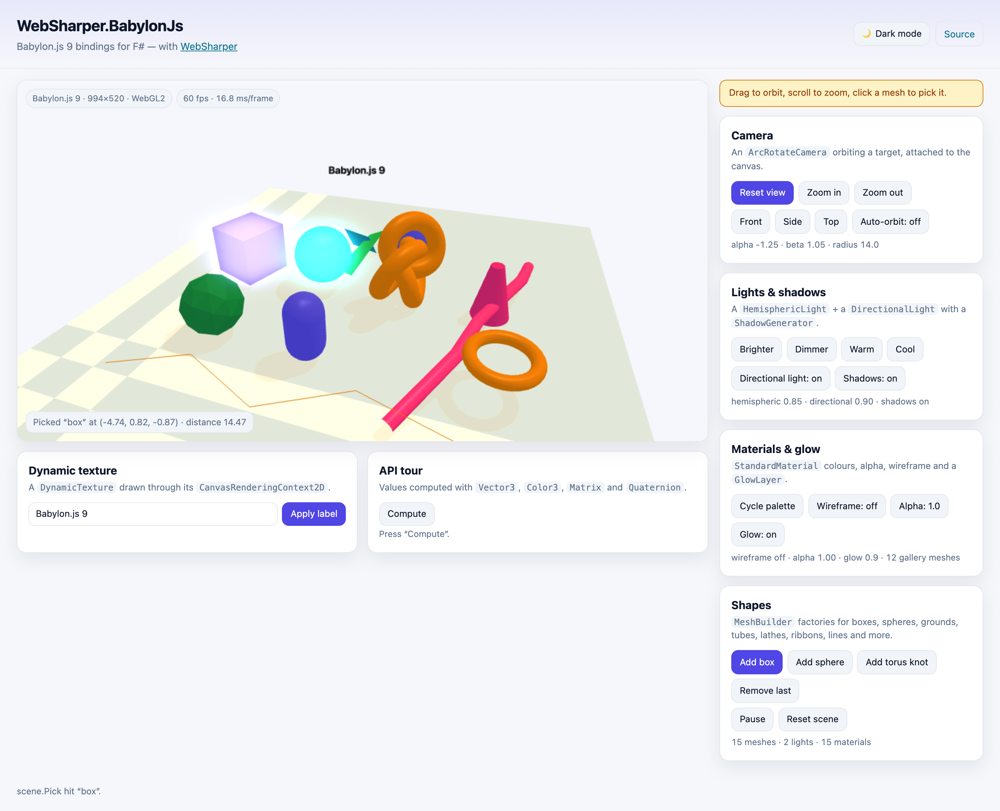

# WebSharper.BabylonJs

[](https://www.nuget.org/packages/WebSharper.BabylonJs)

WebSharper bindings for [Babylon.js](https://www.babylonjs.com/) 9.x — the
WebGL/WebGPU 3D engine — for F# and C# web apps.

The binding consumes the npm package [`@babylonjs/core`](https://www.npmjs.com/package/@babylonjs/core)
as ES modules (`import { Engine } from "@babylonjs/core/Engines/engine.js"`),
so only the modules you use end up in your bundle. There is no CDN `<script>`.

## Live demos

**Try it live:** [Open the sample in your browser](https://dotnet-websharper.github.io/babylonjs/)



The sample doubles as the binding's [test case](#running-the-test-case): it
builds a scene with an `ArcRotateCamera`, hemispheric + directional lights,
a `ShadowGenerator`, a `GlowLayer`, twelve `MeshBuilder` shapes (box, sphere,
ground, cylinder, torus, torus knot, ico sphere, capsule, disc, tube, ribbon,
lathe and an extruded shape), a `DynamicTexture` drawn through a
`CanvasRenderingContext2D`, pointer picking via `scene.onPointerObservable`,
and live edits of materials, lights, the render loop and the scene lifecycle.
It is light-themed by default and has a light/dark theme switcher (persisted in
`localStorage`); switching the theme also restyles the 3D scene.

- **Sample (this repository):** <https://dotnet-websharper.github.io/babylonjs/>
- **Source repository:** <https://github.com/dotnet-websharper/babylonjs>
- **WebSharper bindings:** <https://websharper.com/bindings>

## Repository structure

| Project | Purpose |
| --- | --- |
| `WebSharper.BabylonJs` | The binding: WIG definitions for the math types (`Vector2`, `Vector3`, `Vector4`, `Quaternion`, `Matrix`, `Color3`, `Color4`), the scene graph (`Node`, `TransformNode`, `AbstractMesh`, `Mesh`, `GroundMesh`, `LinesMesh`), cameras (`Camera`, `TargetCamera`, `ArcRotateCamera`, `FreeCamera`), lights (`Light`, `ShadowLight`, `HemisphericLight`, `DirectionalLight`, `PointLight`, `SpotLight`, `ShadowGenerator`), materials and textures (`Material`, `StandardMaterial`, `BaseTexture`, `Texture`, `DynamicTexture`, `GlowLayer`), picking (`Ray`, `PickingInfo`, `PointerInfo`), `Observable<'T>`, the engine (`AbstractEngine`, `ThinEngine`, `Engine`), `Scene` and the `MeshBuilder` factories. |
| `WebSharper.BabylonJs.Sample` | A WebSharper SPA (esbuild → `dist/`) that drives the whole surface. |

## Install

```bash
dotnet add package WebSharper.BabylonJs
```

Or with Paket:

```fsharp
nuget WebSharper.BabylonJs
```

The package targets `netstandard2.0` and works with any WebSharper 10 or 11
project. It supports `@babylonjs/core >= 9.36.0 < 10.0.0`; Babylon.js itself is
pulled from npm, so your JS bundle step must resolve it (WebSharper's
SPA/esbuild build does this automatically).

## Usage

All types live in the `WebSharper.BabylonJs` namespace. As with other WebSharper
bindings, members keep their JavaScript names Pascal-cased (`engine.RunRenderLoop`,
`scene.OnPointerObservable`, `mesh.Position`).

### A minimal scene

```fsharp
open WebSharper
open WebSharper.JavaScript
open WebSharper.BabylonJs

[<JavaScript>]
let Run (canvas: HTMLCanvasElement) =
    let engine = Engine(canvas, true, EngineOptions(PreserveDrawingBuffer = true))
    let scene = Scene(engine)
    scene.ClearColor <- Color4(0.96, 0.97, 0.99, 1.)

    let camera =
        ArcRotateCamera("camera", -1.25, 1.05, 12., Vector3(0., 1., 0.), scene)
    camera.LowerRadiusLimit <- 4.
    camera.UpperRadiusLimit <- 30.
    camera.AttachControl(canvas, true)

    let light = HemisphericLight("light", Vector3(0., 1., 0.), scene)
    light.Intensity <- 0.9

    let mat = StandardMaterial("mat", scene)
    mat.DiffuseColor <- Color3.FromHexString "#4f46e5"
    mat.SpecularColor <- Color3.Black()

    let box = MeshBuilder.CreateBox("box", BoxOptions(Size = 2.), scene)
    box.Material <- mat

    engine.RunRenderLoop(fun () -> scene.Render())
    JS.Window.AddEventListener("resize", fun () -> engine.Resize())
```

### Shadows and glow

```fsharp
let sun = DirectionalLight("sun", Vector3(-0.4, -1., -0.3), scene)
sun.Position <- Vector3(8., 14., 8.)

let shadows = ShadowGenerator(1024, sun)
shadows.UseBlurExponentialShadowMap <- true
shadows.BlurKernel <- 32
shadows.Darkness <- 0.35
shadows.AddShadowCaster box |> ignore

let glow =
    GlowLayer("glow", scene, IGlowLayerOptions(BlurKernelSize = 32))
glow.Intensity <- 0.9
```

### Picking

Picking is driven by Babylon's ray module. Constructing a `Ray` (or calling
`Camera.GetForwardRay`) imports it, after which `Scene.Pick`,
`Scene.PickWithRay` and `PointerInfo.PickInfo` work:

```fsharp
let downward = Ray(Vector3(-4.2, 8., 0.), Vector3.Down(), 50.)
let hit = scene.PickWithRay(downward)

scene.OnPointerObservable.Add(fun info ->
    if info.Type = PointerEventTypes.PointerDown then
        let pick = info.PickInfo
        if not (isNull pick) && pick.Hit then
            let mesh = pick.PickedMesh
            if not (isNull mesh) then
                Console.Log("picked", mesh.Name, pick.PickedPoint))
```

### Dynamic textures

`DynamicTexture` is a real 2D canvas; the binding types `GetContext()` as the
core `CanvasRenderingContext2D`, so you can draw with the WebSharper DOM API:

```fsharp
let tex = DynamicTexture("label", 512, scene, true)
tex.HasAlpha <- true
let ctx = tex.GetContext()
ctx.ClearRect(0., 0., 512., 512.)
ctx.TextAlign <- CanvasTextAlign.Center
ctx.TextBaseline <- CanvasTextBaseLine.Middle
tex.DrawText("Hello", 256, 256, "bold 56px system-ui", "#1e293b", null, true, true)
```

## Notes on the API

- **Deep ESM imports.** Every class is imported from its own
  `@babylonjs/core/...` module, so unused Babylon code is tree-shaken; the
  sample's bundle includes only what it touches.
- **Curated surface.** The binding covers the everyday scene-building API listed
  in the project table. Members are strongly typed (no `obj` escape hatches):
  option objects are `Pattern.Config` types (`BoxOptions`, `SphereOptions`,
  `TubeOptions`, …) with only the documented fields, callbacks are typed
  functions, and `Observable<'T>` / `Observer<'T>` are generic.
- **Picking needs the ray module.** Babylon's `Culling/ray` module registers the
  picking support (`scene.pick` returns a dummy result without it). Use the
  binding's `Ray` type — `PickWithRay`, `Camera.GetForwardRay` — and the module
  is imported for you; after that `Scene.Pick` and `PointerInfo.PickInfo` work.
- **`Nullable<…>` values.** Babylon returns `null` for missing values
  (`PickedMesh`, `ActiveCamera`, …); the binding types them as the class, so
  check with `isNull`.
- **Enums.** `PointerEventTypes`, `Space`, `TextureSamplingMode`,
  `AddressMode` and `PowerPreference` are exposed as typed constants
  (`PointerEventTypes.PointerDown`).

## Running the test case

The sample is a static bundle in `dist/`. Build it in Release and serve it:

```bash
dotnet build WebSharper.BabylonJs.Sample/WebSharper.BabylonJs.Sample.fsproj -c Release
dotnet tool install -g dotnet-serve   # once
dotnet serve -d dist -p 8080
```

Then open <http://localhost:8080>. Drag to orbit, scroll to zoom; click a mesh
to see the pick result. The controls exercise the camera, lights, shadows, glow,
materials, all `MeshBuilder` factories, the render loop, `DynamicTexture`,
picking and the scene lifecycle.

## Build from source

The repository uses Paket and the shared WebSharper build script:

```bash
dotnet tool restore
dotnet paket install
dotnet build WebSharper.BabylonJs.Sample/WebSharper.BabylonJs.Sample.fsproj -c Release
```

The binding and Extensions-less test sample target `netstandard2.0`; the
WebSharper 11 compiler needs the .NET 11 SDK.

## Pack

```bash
WSPackageFolder=/tmp/pkg dotnet fsi ./build.fsx -t WS-Package
```

or, via the shared entry point:

```bash
./build WS-Package
```

On WebSharper 11 the compiler writes a `WebSharper.BabylonJs.websharper`
sidecar next to the assembly; the Paket template ships it alongside the `dll`
and `xml`.

## Deployment

`.github/workflows/ghpages.yml` builds the sample in Release on every push to
`main` and publishes `dist/` to GitHub Pages with
`peaceiris/actions-gh-pages@v3`. Pages must be enabled for the repository with
the `gh-pages` branch as its source.

## License

Apache 2.0 — see [LICENSE.md](LICENSE.md).